<div align="center">

# 🌌 Hierarchical Deep Learning for Zenith-to-Horizon Electron Trajectory Reconstruction in the DAMPE BGO Calorimeter

**Reaching the STK-blind $60^{\circ}$–$90^{\circ}$ band with the BGO calorimeter alone — and raising the detector's effective acceptance by ≈1.8×.**

[](https://www.sciencedirect.com/journal/astroparticle-physics)
[](https://www.python.org/)
[](https://www.tensorflow.org/)
[](https://developer.nvidia.com/cuda-toolkit)
[](https://www.nvidia.com/)
[](#-method-the-hierarchical-framework)
[](#-results)
[](#-results)
[](#-flight-data-cross-check)

<sub>Keywords: Particle Track Reconstruction · Deep Learning · BGO Calorimeter · Large-Angle Events</sub>

</div>

---

## 📖 Table of Contents

| | | |
|---|---|---|
| [✨ At a Glance](#-at-a-glance) | [🔥 The Problem](#-the-problem) | [🧠 Method](#-method-the-hierarchical-framework) |
| [📊 Results](#-results) | [🛰️ Flight Data](#-flight-data-cross-check) | [🔬 Ablation](#-ablation-study-why-the-physics-matters) |
| [🚀 Quick Start](#-quick-start) | [📁 Repository Layout](#-repository-layout) | [⚠️ Scope & Limitations](#-scope--limitations) |
| [📚 Citation](#-citation) | | |

---

## ✨ At a Glance

> **One paragraph.** DAMPE's conventional reconstruction leans on the Silicon-Tungsten Tracker (STK) as its precision anchor. Above ~$60^{\circ}$ the STK drops out of the fiducial volume and the standard pipeline collapses. This project reconstructs the trajectory from the **BGO calorimeter alone**, using a hierarchical two-branch deep learning framework with an SVM router — and it is checked against real flight data.

| | Metric | Standard BGO Algorithm | **This work** |
|---|---|---|---|
| 🎯 | Angular resolution $\Psi_{68}$, $0^{\circ}$–$60^{\circ}$ | $3.78^{\circ}$ | **$1.40^{\circ}$** (PGHNN) — ×2.7 |
| 🎯 | Angular resolution $\Psi_{68}$, $60^{\circ}$–$90^{\circ}$ | $32.73^{\circ}$ | **$1.31^{\circ}$** (DLD) — ×25 |
| ⚡ | Efficiency, $0^{\circ}$–$30^{\circ}$ | 98.73% | **100%** |
| ⚡ | Efficiency, $30^{\circ}$–$60^{\circ}$ | 91.06% | **99.47%** |
| ⚡ | Efficiency, $60^{\circ}$–$90^{\circ}$ | 38.58% | **99.50%** |
| 🧭 | Routing accuracy (SVM) | — | **98.4%** |
| 📍 | Impact-point precision, P68 | — | **3.3 cm** / **3.8 cm** |
| 🔭 | Effective acceptance vs $0^{\circ}$–$60^{\circ}$ | baseline | **≈ 1.8×** |
| 🛰️ | Flight-vs-STK agreement ($30^{\circ}$–$71^{\circ}$) | — | **median $1.44^{\circ}$**, P68 $1.98^{\circ}$ |

*Resolution and efficiency are Monte Carlo values for electrons in 100 GeV–1 TeV over $0^{\circ}$–$90^{\circ}$ zenith. The flight-vs-STK number is a consistency check between two reconstructions, **not** an absolute resolution — see [Flight Data](#-flight-data-cross-check).*

---

## 🔥 The Problem

The BGO calorimeter's 308 bars map naturally onto a $14 \times 22$ grid, providing a full tomographic view of shower development. In the standard pipeline, a coarse BGO shower-axis estimate *seeds* an STK track search; the STK then supplies the precise angle. That synergy yields $\sim 0.2^{\circ}$ near 10 GeV — but only while the particle actually crosses **all three** of PSD, STK, and BGO simultaneously.

Beyond roughly $60^{\circ}$, incident particles bypass the STK fiducial volume (or clip only a few layers, too few to form a track candidate). Kalman-filter tracking becomes inapplicable. Meanwhile the official DAMPE **energy-weighted Center-of-Gravity (CoG) track reconstruction** — hereafter the **Standard BGO Algorithm** — degrades badly: large-angle showers **leak out of the side** of the calorimeter, so the energy-weighted centroid shifts systematically away from the true shower axis, and the few layers traversed make the CoG track fit unstable.

<p align="center">
  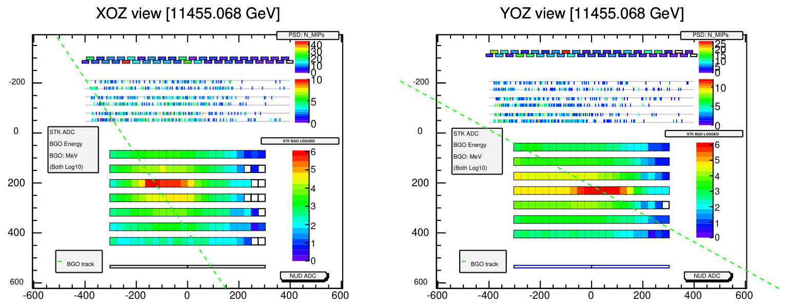
  <br>
  <sub><b>Figure 1.</b> The geometric limitation. The green dashed line is the BGO-only track from the Standard BGO Algorithm — a large-angle trajectory that crosses the BGO calorimeter but bypasses the PSD and STK detectors.</sub>
</p>

**The window we target:** events in $60^{\circ}$–$90^{\circ}$ that the STK-based pipeline discards. This work **complements** STK reconstruction rather than competing with it — it does not aim to beat $\sim 0.2^{\circ}$ inside the STK's own acceptance, it aims to make the rest of the hemisphere usable at all.

> The "efficiency cliff" is only half the story. In $60^{\circ}$–$90^{\circ}$ the Standard BGO Algorithm still returns *some* answer (38.58% within the $10^{\circ}$ criterion), but at $\Psi_{68} = 32.73^{\circ}$ — the majority of large-angle events carry unusable directions.

---

## 🧠 Method: The Hierarchical Framework

Electromagnetic showers look qualitatively different depending on incidence angle, so a single monolithic model is the wrong tool. The framework routes at $60^{\circ}$ and hands each half to a specialist. The two experts are trained on **overlapping** angular ranges ($0^{\circ}$–$70^{\circ}$ and $50^{\circ}$–$90^{\circ}$) but remain **routed** at $60^{\circ}$.

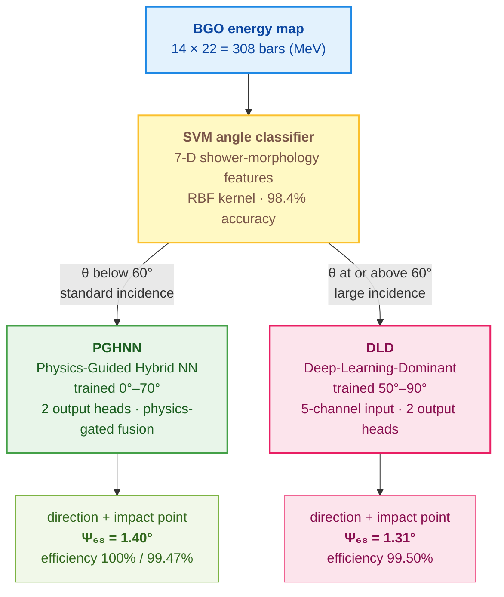

### 1️⃣ Angle Classifier — the prerequisite for unlabeled data

Flight data carry **no ground-truth incident-angle labels**, so an automatic router is not optional. Rather than feeding the raw 308-dimensional energy vector, the classifier works on a compact **7-D physics feature vector** derived from the $14\times22$ matrix:

- **Longitudinal (depth) RMS** $\sigma_{\rm long}$ — energy-weighted RMS spread of the layer index (in *layers*)
- **Lateral RMS width** $\sigma_{\rm lat}$ — average over 14 layers of the energy-weighted RMS spread of bar index (in *bars*)
- **Shower-axis slope magnitude** $s_{\rm mag} = \sqrt{s_x^2 + s_y^2}$ — energy-weighted linear regression of each layer's transverse centroid vs. layer index, computed separately for the X-view (even layers) and Y-view (odd layers)
- **Four basic quantities** — layer of maximum deposition, total deposited energy, and the individual slope projections $|s_x|$, $|s_y|$

Every quantity is expressed in the detector's **native bar/layer indices** rather than physical distances, which keeps them scale-free and directly measurable in unlabeled flight data.

**Setup:** scikit-learn `SVC`, RBF kernel ($C=10$, $\gamma=\texttt{scale}$), preceded by a `StandardScaler`. Trained on a class-balanced sample of **50,000** Monte Carlo events drawn from a stratified pool of **300,000**, with an 80/20 train/test partition, labeled by the true threshold $\theta > 60^{\circ}$.

| Class | Precision | Recall | F1 |
|---|---|---|---|
| Standard-angle ($0^{\circ}$–$60^{\circ}$) | 0.988 | 0.986 | 0.987 |
| Large-angle ($60^{\circ}$–$90^{\circ}$) | 0.982 | 0.980 | 0.981 |
| **Overall accuracy** | | | **98.4%** |

> **How much does imperfect routing cost?** A routing ablation replaces the learned classifier with an *oracle* (perfect) router; the global $\Psi_{68}$ changes by only **$0.03^{\circ}$**. Errors concentrate near the $60^{\circ}$ boundary — and because both experts are now trained across that boundary, misrouting no longer produces a localized dip in resolution.

### 2️⃣ PGHNN — standard incidence ($0^{\circ}$–$60^{\circ}$)

Here showers are well contained and the CoG prior is strong, so instead of discarding physics we embed it. This is deliberately a **"gray-box"** model: physically consistent, but still fully learnable.

<p align="center">
  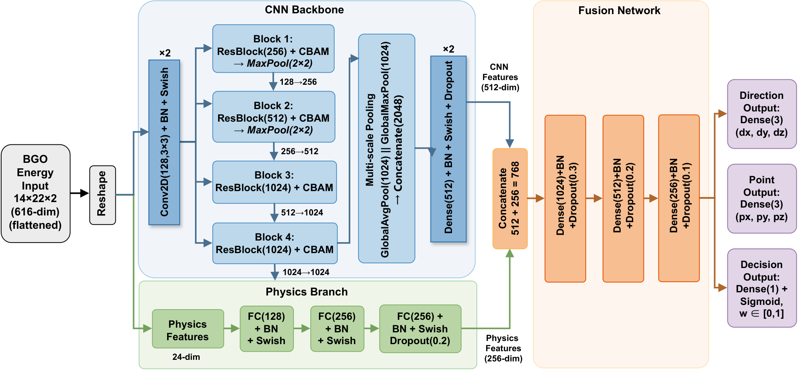
  <br>
  <sub><b>Figure 2.</b> The Physics-Guided Hybrid Neural Network (PGHNN). A dual-stream design fuses BGO energy maps with physics features, feeding a fusion network that drives <b>two</b> output heads: direction $\vec{D}_{\rm dl}$ and impact point $\vec{P}_{\rm dl}$. At inference the trajectory is fused with the analytic (Standard BGO Algorithm) reconstruction through a gate $I_{\rm valid}$ derived from the fit validity.</sub>
</p>

- **Input** — $2$-channel tensor $(14, 22, 2)$: per-event **normalized** energy $E_{ij}/\sum E$ (relative shower shape) and **log-transformed** energy $\ln(1+E_{ij})$ (compresses the GeV→TeV dynamic range while preserving low-energy periphery), reshaped by a dedicated `BGOInput` layer.
- **CNN stream** — two `Conv2D(128)` layers (BN + Swish), then four residual blocks with **CBAM** attention at increasing depth ($256 \to 512 \to 1024 \to 1024$ filters); the first two are followed by $2\times2$ max-pooling. **Multi-scale pooling** (GlobalAverage + GlobalMax over the 1024-channel maps) concatenates to $2048$-D, compressed by two `Dense(512)` layers into a $512$-D feature vector.
- **Physics stream** — the $24$-D feature vector through $128 \to 256 \to 256$ (BN + Swish, dropout $0.2$ at the end).
- **Fusion** — the two streams concatenate to $768$-D and pass through a $1024 \to 512 \to 256$ fusion network feeding the two heads.
- **Physics-gated fusion** — this is the physics doing real work:

$$\vec{D}_{\text{final}} = I_{\text{valid}}\cdot \vec{D}_{\text{phy}} + (1-I_{\text{valid}})\cdot \vec{D}_{\text{dl}}$$

  where $I_{\text{valid}} \in [0,1]$ equals $1$ only when the CoG track fit converges to a non-degenerate solution (positive, in-acceptance projected uncertainties and energy above a minimum) and decays smoothly as fit quality degrades. **This guarantees a safe fallback**: whenever the analytic method fails, $I_{\text{valid}}=0$ and the prediction reduces cleanly to the network estimate.

> **Why this is the right regime for physics guidance:** the energy-weighted CoG prior is trustworthy for clean showers and untrustworthy for complex ones — exactly the split the gate arbitrates. At large incidence the same prior becomes systematically biased and frequently degenerate, so the large-angle branch **does not use it at all**: it has no analytic input and no gate, and its direction comes straight from the network.

### 3️⃣ DLD — large incidence ($60^{\circ}$–$90^{\circ}$)

Side leakage destroys the analytic prior, so here deep learning leads.

<p align="center">
  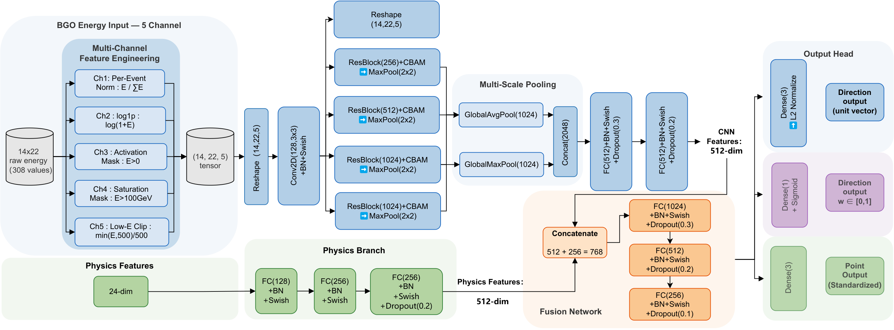
  <br>
  <sub><b>Figure 3.</b> The Deep-Learning-Dominant (DLD) architecture. A 5-channel BGO input plus a 24-D handcrafted vector feed a CNN backbone with residual blocks and CBAM attention, jointly predicting direction and impact point.</sub>
</p>

**Enhanced 5-channel input** $(14, 22, 5)$ — engineered for truncated, leaking showers:

| Ch | Content | Purpose |
|---|---|---|
| **1** | $E_{ij} / \sum E$ | relative shower shape |
| **2** | $\ln(1 + E_{ij})$ | low-energy peripheral detail, compressed dynamic range |
| **3** | $\mathbb{I}(E_{ij} > 0)$ | activation mask — where deposition exists |
| **4** | $\mathbb{I}(E_{ij} > 100\ \text{GeV})$ | **saturation mask** — TeV-scale showers push single-crystal digitiser channels toward saturation |
| **5** | $\min(E_{ij}, 500\ \text{MeV}) / 500$ | **low-energy clip** — isolates peripheral topology by capping core deposits |

The physics stream receives a **regime-specific** 24-D vector — distinct from *both* the 7-D classifier vector and the 24-D standard-angle vector. Per layer pair (7 pairs) it carries the normalized Y-view energy, the normalized X-view energy, and the energy-weighted centroid of the Y-view bars; plus three globals: $\log$ of total deposited energy, active-bar fraction, and the shower-maximum layer index.

**Two tasks, one pass:** (1) direction — a 3-D unit vector, L2-normalized so $|\vec{D}|=1$; (2) impact point — coordinates on the **generation sphere** of radius $R = 1.38$ m (centred on the detector axis, 24.7 cm above the geometric centre of the BGO), representing the true incident location from the Monte Carlo. The point prediction is standardized using training-set statistics.

**Curriculum learning on the impact point.** Predicting direction *and* impact point jointly under grazing incidence is hard — leakage destroys part of the spatial information. So the point head starts **dormant**: a `PointWeightAnnealing` schedule holds its loss weight at zero for the first **15 epochs**, ramps it linearly to **0.1** over epochs **15–30**, then holds it fixed. This stops the point gradient from disrupting the direction head early on.

### 4️⃣ Loss Functions — where the two branches diverge

| Component | Standard ($0^{\circ}$–$60^{\circ}$) | Large-angle ($60^{\circ}$–$90^{\circ}$) |
|---|---|---|
| Direction loss | $0.1\,\mathcal{L}_{\rm MSE} + 0.9\,(1-\cos\theta)^2$ | $0.1\,\mathcal{L}_{\rm MSE} + 0.9\,(1-\cos\theta) + 0.05\,\mathcal{L}_{\rm flip}$ |
| Flip penalty | *not used* | $\lambda\,\mathbb{I}(z_{\rm p}z_{\rm t} < 0)$, $\lambda = 0.05$ |
| Point loss | $w_{\rm pt}\,\mathcal{L}_{\rm Huber,\delta_H=2.0}$, $w_{\rm pt}=0.01$ | $w_{\rm pt}(t)\,\mathcal{L}_{\rm Huber,\delta_H=0.5}$, annealed $0 \to 0.1$ (ep. 15–30) |

**On the hemisphere ambiguity.** A BGO-only reconstruction cannot in principle tell whether a shower came from above or below — the calorimeter records energy deposition, not incidence *direction*. The flip penalty resolves this at training time by penalising predictions whose $z$-component has the opposite sign to the Monte Carlo truth. Because the training sample is downward-going ($0^{\circ} \le \theta \le 90^{\circ}$), the model implicitly adopts the downward convention and assumes downward incidence at inference — **valid for the validated $0^{\circ}$–$90^{\circ}$ range only.** Extending upward to $90^{\circ}$–$130^{\circ}$ will require either an explicit hemisphere classifier or the earliest shower-development layer as a directional prior.

<details>
<summary><b>⚙️ Training protocol & implementation details</b> (click to expand)</summary>

| | Standard-angle (PGHNN) | Large-angle (DLD) |
|---|---|---|
| Optimizer | Adam, `clipnorm=1.0` | Adam, `clipnorm=1.0` |
| LR schedule | `CyclicalLearningRate` (base $10^{-5}$, max $8\times10^{-4}$, step 2500) | `WarmupLR` 3000 steps from $2\times10^{-5}$, then `CyclicalLearningRate` (same) |
| Batch size | 2048 | 2048 |
| Epochs | up to 200, early stopping (patience 20, monitoring validation angular error) | up to 200 |
| **Training angular support** | **$0^{\circ}$–$70^{\circ}$** | **$50^{\circ}$–$90^{\circ}$** |
| Physics features | 24-D | 24-D (regime-specific) |

The two experts are trained on **overlapping but not identical** angular sub-ranges of the same Monte Carlo sample, so both see showers from either side of the $60^{\circ}$ threshold. The routing rule is unchanged: the SVM still splits at $60^{\circ}$, and inference remains a single hard routing decision. The 80/20 train/test partition is unchanged.

**Hardware / stack:** single NVIDIA A100 (80 GB), CUDA 11.7, cuDNN 8.6.0.163, TensorFlow 2.10, Python 3.10.
**Cost:** $\approx 1.5$ ms per event on GPU; $\approx 20$ h per full training run — feasible for offline ground processing of the DAMPE downlink stream.

**Dataset:** 11,894,154 selected Geant4 events, of which the 80% training partition is **9,515,323**, with the remaining 20% held out for evaluation, stratified by $(\theta, E)$.

</details>

---

## 📊 Results

### Reconstruction efficiency

| Method | $0^{\circ}$–$30^{\circ}$ | $30^{\circ}$–$60^{\circ}$ | $60^{\circ}$–$90^{\circ}$ |
|---|---|---|---|
| Standard BGO Algorithm | 98.73% | 91.06% | **38.58%** |
| **PGHNN** (this work) | **100%** | **99.47%** | — |
| **DLD** (this work) | — | — | **99.50%** |

*Efficiency = fraction of the events entering the evaluation that are reconstructed with $\psi < 10^{\circ}$. The same denominator is used for every method, and no trigger-efficiency correction is applied.*

### Angular resolution

<p align="center">
  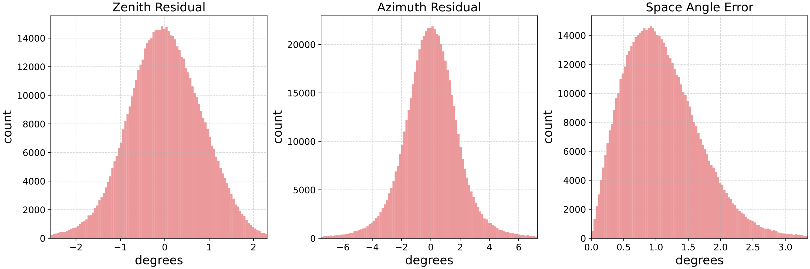
  <br>
  <sub><b>Figure 4a.</b> Standard-angle regime (PGHNN): zenith residual, azimuth residual, space-angle error — symmetric, unimodal, centred near zero.</sub>
</p>

<p align="center">
  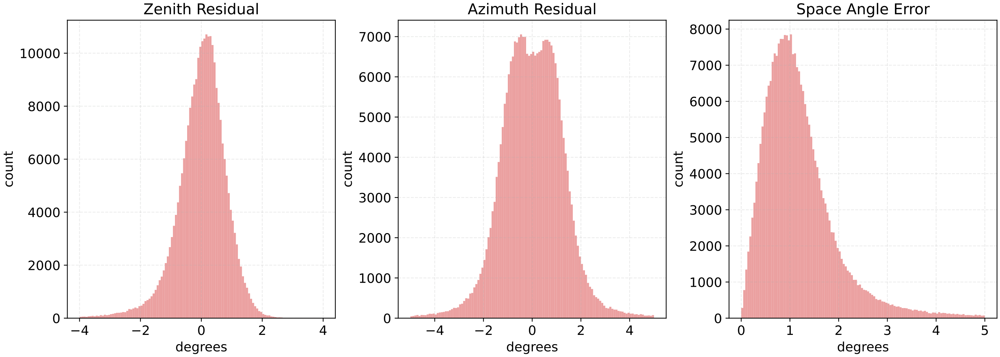
  <br>
  <sub><b>Figure 4b.</b> Large-angle regime (DLD): the same overall shape, modestly broader — particularly in azimuth and space angle — reflecting the extra difficulty posed by shower leakage.</sub>
</p>

| Method | $\Psi_{68}$ |
|---|---|
| Conventional BGO+STK pipeline ($0^{\circ}$–$60^{\circ}$) † | **0.2°** |
| Standard BGO Algorithm ($0^{\circ}$–$60^{\circ}$) | 3.78° |
| Standard BGO Algorithm ($60^{\circ}$–$90^{\circ}$) | 32.73° |
| **PGHNN** ($0^{\circ}$–$60^{\circ}$) | **1.40°** |
| **DLD** ($60^{\circ}$–$90^{\circ}$) | **1.31°** |

<sub>† Reference only. Quoted at 10 GeV from the DAMPE STK performance paper; it operates within $0^{\circ}$–$60^{\circ}$ and is **not evaluated** on the 100 GeV–1 TeV sample used here, so it is not directly comparable to the BGO-only methods. The Standard BGO Algorithm entries come from the official DAMPE energy-weighted CoG track reconstruction applied to the *same* Monte Carlo electron sample as the two networks. $\Psi_{68}$ = 68% containment radius of the space-angle error.</sub>

### Energy dependence & stability

<p align="center">
  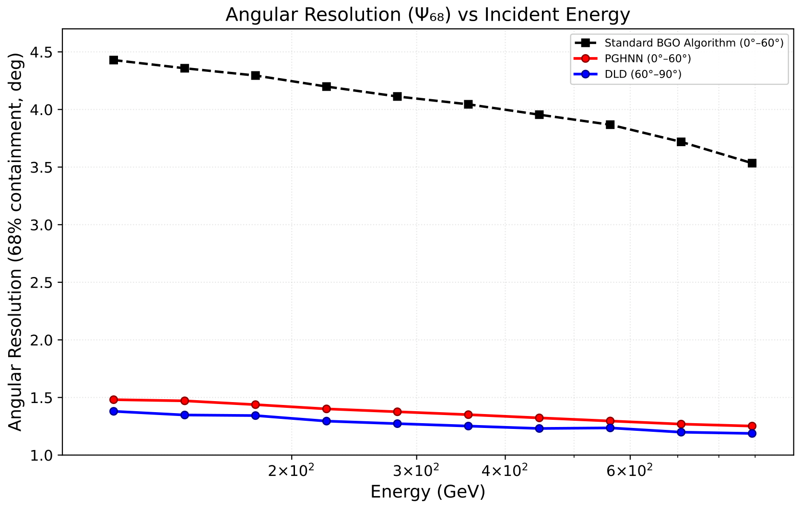
  <br>
  <sub><b>Figure 5.</b> $\Psi_{68}$ vs. incident energy over 100 GeV–1 TeV: Standard BGO Algorithm (black dashed, $0^{\circ}$–$60^{\circ}$), PGHNN (red), DLD (blue).</sub>
</p>

| Method | 100 GeV | $\sim$1 TeV | Trend |
|---|---|---|---|
| Standard BGO Algorithm | $\sim 4.0^{\circ}$ ($\sim 4.05^{\circ}$ near 150 GeV) | $\sim 3.5^{\circ}$ | Mild energy dependence; integrated value $3.78^{\circ}$ |
| **PGHNN** | $\sim 1.5^{\circ}$ | $\sim 1.3^{\circ}$ | Nearly flat |
| **DLD** | $\sim 1.4^{\circ}$ | $\sim 1.2^{\circ}$ (at $\sim$900 GeV) | Monotonic; stays below $1.5^{\circ}$ throughout |

> **The flatness is the interesting part.** Both network curves change far less with energy than the analytic method, which is statistics-limited. The physics-guided PGHNN extracts topological features of the shower axis that are largely insensitive to energy scale, compensating for the fluctuations that limit analytic approaches at low energy.

### Impact-point precision

Arc-length error is the great-circle distance on the $R = 1.38$ m reference sphere between the true incident point and the **upstream (entrance-side)** crossing of the reconstructed line:

$$s = R \cdot \arccos\!\left(\hat{\mathbf{u}}_{\rm true} \cdot \hat{\mathbf{u}}_{\rm pred}\right)$$

<p align="center">
  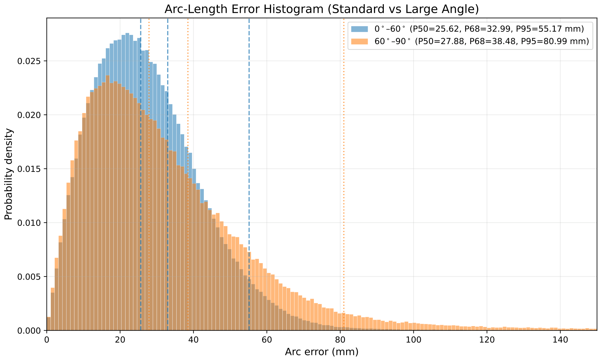
  <br>
  <sub><b>Figure 6.</b> Arc-length error distributions: standard-angle (blue, $0^{\circ}$–$60^{\circ}$) and large-angle (orange, $60^{\circ}$–$90^{\circ}$), as normalized densities. Vertical lines mark P50 / P68 / P95.</sub>
</p>

| Regime | P68 | P95 |
|---|---|---|
| $0^{\circ}$–$60^{\circ}$ | **32.99 mm** (3.3 cm) | 55.17 mm |
| $60^{\circ}$–$90^{\circ}$ | **38.48 mm** (3.8 cm) | 80.99 mm |

> **This is not a second measurement of the direction.** The predicted impact point sits close to the reference sphere, so the reconstructed line meets it close to $\vec{P}_{\rm pred}$; only the residual radial offset acts as a lever arm for the directional error, and for the resolutions reported here ($\sim$1.3°–1.4°) it contributes well under a millimetre. The arc-length error therefore measures the **tangential accuracy of the impact-point prediction** — and on that basis the two regimes compare directly: the entry point is located to 3.3 cm (P68) at standard angles and 3.8 cm at large angles, a degradation of only about **17%** even where the shower is truncated by side leakage.

The two distributions differ chiefly in their **tails**: the standard-angle one decays rapidly beyond $\sim$55 mm, while the large-angle one extends beyond $\sim$100 mm. Centimetre-level impact-point precision (P68 $<$ 5 cm) is what lets electron–hadron separation variables (shower core, isolation cone — both defined *relative to the axis*) be extended into the large-angle regime.

<p align="center">
  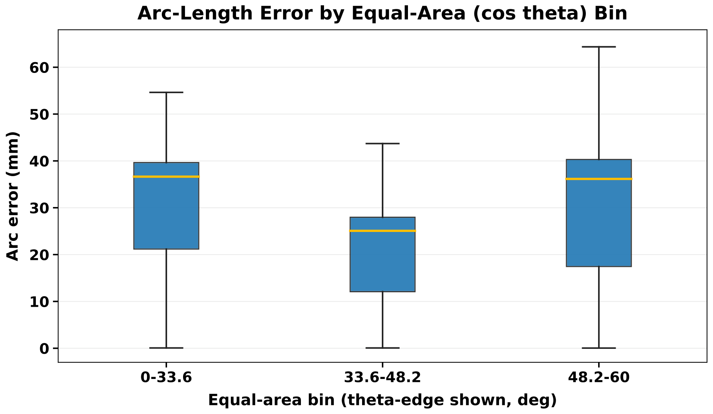
  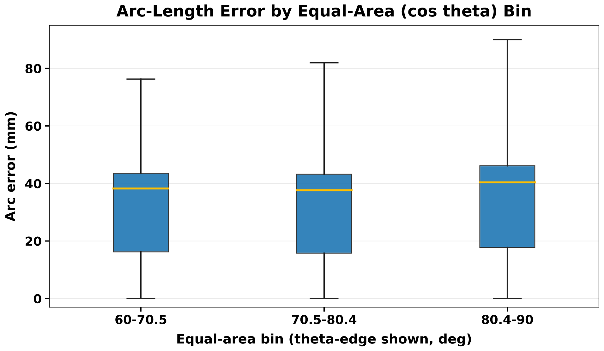
  <br>
  <sub><b>Figure 7.</b> Arc-length error by equal-area $\cos\theta$ bins. Box = Q1–Q3, yellow line = P68, whiskers = min to P95. Standard-angle P68: $\sim$37 mm / 25 mm / 36 mm. Large-angle P68: $\sim$38 mm / 38 mm / 41 mm. P95 stays below 100 mm in every bin.</sub>
</p>

### Boundary behaviour — why $60^{\circ}$ works

A hard-threshold router is intrinsically sensitive to how the two experts behave *at* that threshold. If each were trained only on its own disjoint domain, events near $60^{\circ}$ would be reconstructed by a model sitting at the edge of its training support, and $\Psi_{68}$ could jump when the classifier switches branches. The fix is to **extend the training support by $10^{\circ}$ on each side** — PGHNN on $0^{\circ}$–$70^{\circ}$, DLD on $50^{\circ}$–$90^{\circ}$ — while keeping the routing rule at $60^{\circ}$.

<p align="center">
  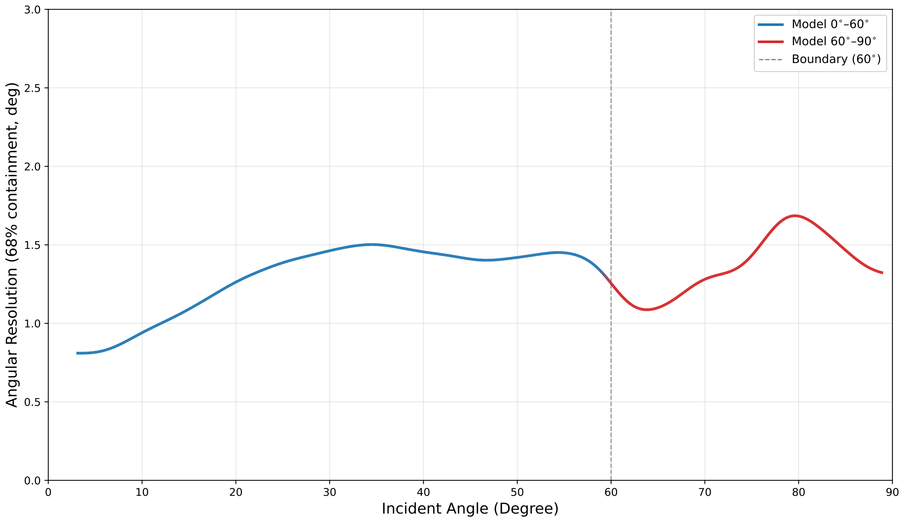
  <br>
  <sub><b>Figure 8.</b> Routed $\Psi_{68}$ vs. incident angle across $0^{\circ}$–$90^{\circ}$; each branch is evaluated only in the interval to which it is routed. Both models were trained on overlapping ranges, so the two branches join continuously at the threshold. No extrapolation beyond either model's training support is shown.</sub>
</p>

- The branches **join continuously at $60^{\circ}$**: both give $\Psi_{68} \approx 1.2^{\circ}$–$1.3^{\circ}$ there, and the step seen with disjoint training domains is gone.
- Resolution stays **below $\sim 1.7^{\circ}$ over the full range**: rising from $\sim 0.8^{\circ}$ at small zenith to $\sim 1.5^{\circ}$ near $35^{\circ}$, a shallow local minimum of $\sim 1.1^{\circ}$ near $63^{\circ}$, a broad local maximum of $\sim 1.7^{\circ}$ near $79^{\circ}$, then back to $\sim 1.3^{\circ}$ at $90^{\circ}$.
- The choice of $60^{\circ}$ rests on **two independent mechanisms that coincide there** — the STK fiducial-volume cutoff and the degradation of the Standard BGO Algorithm — together with the continuity of the routed resolution at that angle.
- Predictions are **not blended** at inference. A continuous soft-transition scheme across the overlap band is left for future work.

---

## 🛰️ Flight Data Cross-Check

Monte Carlo results are necessary but not sufficient. As a first check on real detector data, the pipeline is applied to flight electron candidates that leave a reconstructable track in **both** the STK and the BGO calorimeter, with STK zenith angles between $30^{\circ}$ and $71^{\circ}$ (**N = 391,148**). The STK track serves as an independent reference direction, and $\psi$ is the space angle between the BGO-only prediction and that track.

<p align="center">
  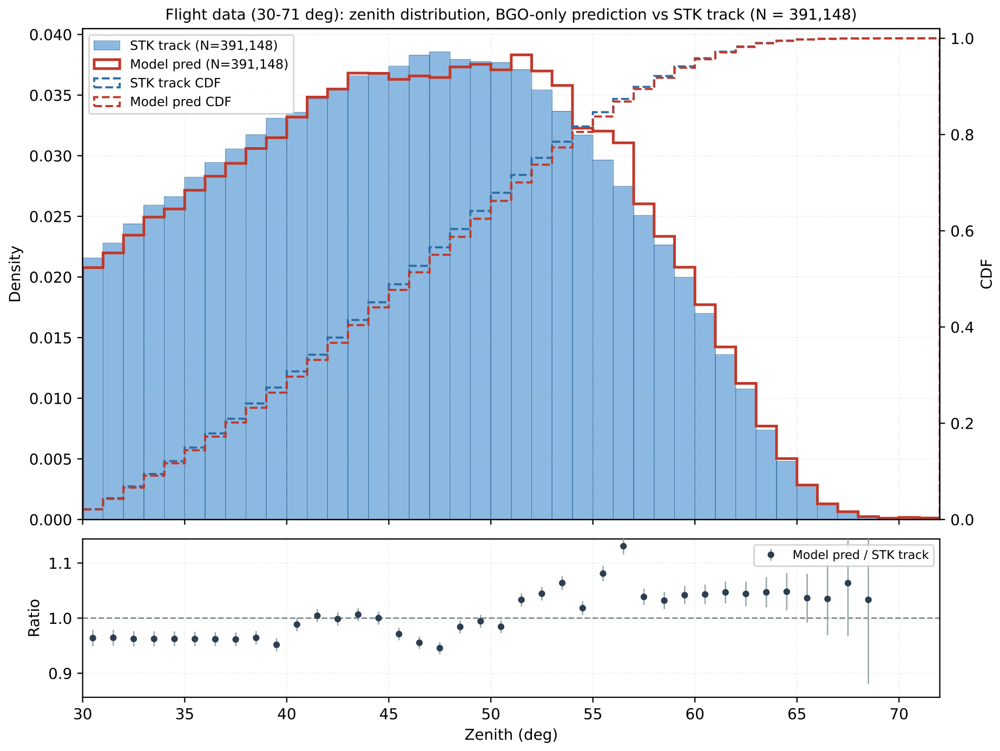
  <br>
  <sub><b>Figure 9.</b> Zenith distributions reconstructed by the BGO-only model and by the STK. <i>Top:</i> normalized histograms plus cumulative distributions. <i>Bottom:</i> ratio per $1^{\circ}$ bin; error bars are $\sigma(R)/R=\sqrt{1/N_{\rm pred}+1/N_{\rm STK}}$; only bins with ≥ 50 events in both samples are shown.</sub>
</p>

The two shapes agree closely over most of the interval and peak between $45^{\circ}$ and $52^{\circ}$. The ratio stays within **0.95–1.13**, with a median absolute deviation from unity of **0.04**. The largest local difference is in $\sim 53^{\circ}$–$62^{\circ}$ (ratio $1.13$); smaller systematic deficits appear at $30^{\circ}$–$40^{\circ}$ ($\sim$0.96) and $45^{\circ}$–$50^{\circ}$ ($\sim$0.97). These excursions exceed the bin-wise statistical uncertainty of $\sim$0.01–0.02. Both samples show a dip near $54^{\circ}$–$55^{\circ}$, attributed to the event selection rather than to the model.

<p align="center">
  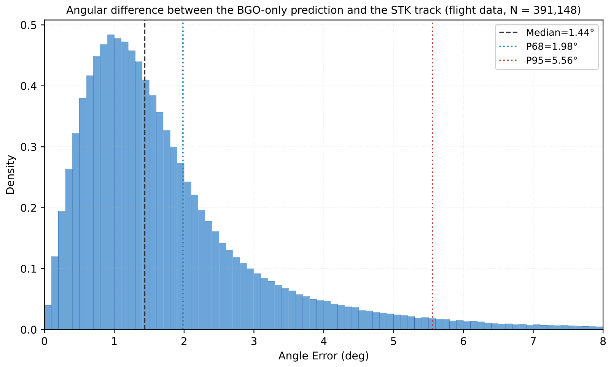
  <br>
  <sub><b>Figure 10.</b> Distribution of $\psi$ for the flight sample. Dashed / dotted / dash-dotted lines mark the median ($1.44^{\circ}$), P68 ($1.98^{\circ}$) and P95 ($5.56^{\circ}$).</sub>
</p>

| Quantity | Value |
|---|---|
| Sample | flight electron candidates, $30^{\circ}$–$71^{\circ}$, N = 391,148 |
| Median $\psi$ | **1.44°** |
| 68th percentile | **1.98°** |
| 95th percentile | 5.56° |

<p align="center">
  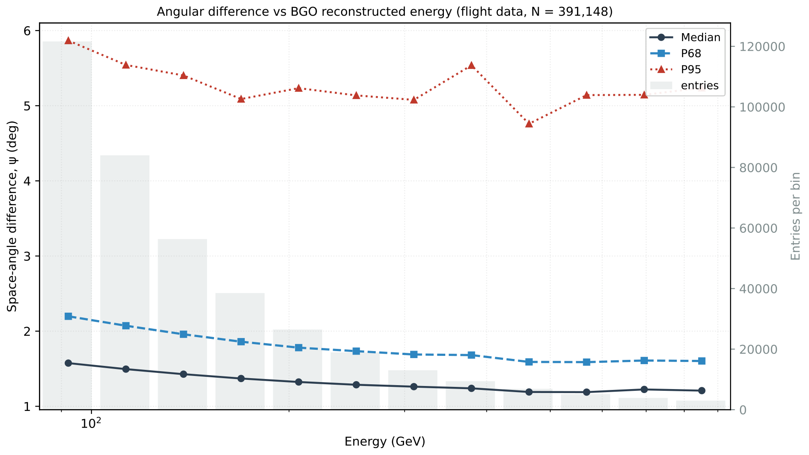
  <br>
  <sub><b>Figure 11.</b> Energy dependence of $\psi$, binned in logarithmically equal-width intervals of the BGO reconstructed energy between 83.3 and 941.2 GeV. Median (black circles), P68 (blue squares), P95 (red triangles); grey bars give the entries per bin.</sub>
</p>

Over 83.3–941.2 GeV the median falls from $\sim 1.6^{\circ}$ to $\sim 1.2^{\circ}$ and P68 from $\sim 2.2^{\circ}$ to $\sim 1.6^{\circ}$; P95 declines more gently ($\sim 5.9^{\circ} \to \sim 5.1^{\circ}$) with bin-to-bin scatter up to $\sim 0.8^{\circ}$. As a tail statistic, P95 responds most strongly to the small subpopulation of poorly reconstructed events (misrouted near $60^{\circ}$, degraded STK track quality at large zenith, residual contamination) — no single cause is assigned.

> **Read this comparison carefully.** The STK track has a finite resolution of its own and is **not a truth label**. $\psi$ therefore describes how well two reconstructions agree; it does **not** yield the absolute angular resolution of the BGO-only model. The 68th percentile of $1.98^{\circ}$ is measured on this sample against the STK, and is **not directly comparable** to the Monte Carlo $\Psi_{68}$ of $1.40^{\circ}$ / $1.31^{\circ}$ — a difference between the two would not by itself indicate degradation or confirm the simulation. The sample also contains only events that *have* an STK track, so it never reaches the $71^{\circ}$–$90^{\circ}$ STK-blind region that motivates the large-angle branch; the $60^{\circ}$–$71^{\circ}$ events that retain an STK track are a biased subset.

---

## 🔭 Physics Impact — effective acceptance

DAMPE is not a ground-based module viewing the sky through a $\cos\theta$ projected area — it is a **free-flying six-faced box**, so a particle may enter through the top face *or* any of the four side faces. The acceptance is therefore evaluated from the full projected area (Cauchy projection formula):

$$A_{\rm proj}(\theta,\phi) = L_xL_y\cos\theta + L_xL_z|\sin\theta\sin\phi| + L_yL_z|\sin\theta\cos\phi|$$

Integrating over solid angle up to $\theta_{\max}$ with the BGO active bounding box ($L_x = 60$ cm bar length, $L_y = 22\times2.5 = 55$ cm packed width, $L_z = 14\times2.5 = 35$ cm depth, $\sim$31 radiation lengths):

$$\frac{G(90^{\circ})}{G(60^{\circ})} \approx \boxed{1.81}$$

What a physics analysis actually gains is the ***effective*** **acceptance** — the geometric acceptance weighted by the probability of reconstructing a *usable* direction. The ratio above assumes the conventional BGO+STK chain is fully efficient below $\theta_c$ and contributes nothing above it, while the new chain is fully efficient everywhere. The second assumption is borne out by the measured $99.47\%$ ($30^{\circ}$–$60^{\circ}$) and $99.50\%$ ($60^{\circ}$–$90^{\circ}$).

So **≈ 1.8** is quoted as an **effective-acceptance ratio**, not a purely geometric one. Equivalently, the newly accessible $60^{\circ}$–$90^{\circ}$ annulus contributes a geometric acceptance equal to $\sim$**80%** of the previously covered $0^{\circ}$–$60^{\circ}$ range. For rare-event physics — monochromatic gamma-ray line searches, TeV electron spectra — where flux is low and **statistical uncertainty dominates**, that gain is directly valuable.

---

## 🔬 Ablation Study: why the physics matters

A claim of "physics guidance" is worth nothing unless the components are *measured* rather than *asserted*. Ablation on the standard-angle PGHNN:

| Configuration | $\Psi_{68}$ | Δ |
|---|---|---|
| **Full PGHNN** (24 physics features + dynamic fusion) | **1.40°** | — |
| − without the 24 physics features (energy-map only) | 1.81° | **+0.41°** |
| − without dynamic fusion (always trust DL, $I_{\rm valid}\equiv 0$) | 1.56° | +0.16° |
| − reduced input (single channel) | 1.49° | +0.09° |

- Removing hand-crafted physics features costs **$0.41^{\circ}$** — the geometric priors are not something the convolutional backbone recovers on its own.
- Disabling the physics gate costs $0.16^{\circ}$ — arbitration between analytic and data-driven branches contributes modestly but consistently.
- Collapsing the dual-channel input to single-channel costs another $0.09^{\circ}$ — the log channel earns its place.

Each improvement comes from a **concrete, separable component** inside a measurable gray-box framework, not from an opaque black box.

---

## 🚀 Quick Start

### Requirements

```bash
python >= 3.10
tensorflow == 2.10       # CUDA 11.7 / cuDNN 8.6.0.163 for GPU
numpy
scikit-learn             # SVM router fitting
```

### Data layout

Both experts read TFRecord shards. Paths are placeholders — set `BGO_DATA_DIR` or edit the top of each script:

```
data/
├── train.tfrecord                 # standard-angle sample  (0°–70°)
├── val.tfrecord
├── large_angle_train.tfrecord     # large-angle sample     (50°–90°)
└── large_angle_val.tfrecord
```

Simulation samples and trained weights are **not** distributed with this repository — see [Data & Code Availability](#-data--code-availability).

### Train the experts

```bash
python tools/standard.py       # PGHNN — standard angle (0°–70° training support)
python tools/large_angle.py    # DLD   — large angle    (50°–90° training support)
```

Each script builds its own input pipeline, constructs the network, trains with early stopping on `val_direction_output_angle_error`, and writes checkpoints, a CSV training history and the final model.

### Train the routing classifier

```bash
python tools/train_angle_classifier.py    # reads $BGO_ANGLE_CSV, writes $BGO_SVM_OUT
```

The SVM needs a CSV with `barE_0 … barE_307` and `PriDirec_0 … PriDirec_2` columns. It derives the 7-D morphology features and the $\theta > 60^{\circ}$ label from those, then fits `StandardScaler → SVC(kernel="rbf", C=10, gamma="scale")` on 50,000 events.

### Event representation

Each event is a $14 \times 22$ BGO energy matrix in MeV — 308 values, row-major, `barE[layer=0, bar=0..21], barE[1, 0..21], ..., barE[13, 0..21]`. Layers alternate orientation (odd → Y-view, even → X-view).

From that matrix the models derive:

- a **2-channel energy map** $(14,22,2)$ — event-normalized energy $E_{ij}/\sum E$ and $\ln(1+E_{ij})$ — for the PGHNN; **5 channels** for the DLD, adding an activation mask, a 100 GeV saturation mask and a 500 MeV low-energy clip;
- a **24-D physics feature vector**, regime-specific (layer-wise energy, per-layer shower maximum and its bar position, global energy-weighted centroid; the large-angle variant is specified in the paper).

---

## 📁 Repository Layout

```
.
├── tools/
│   ├── standard.py                # PGHNN — physics-guided hybrid model (0°–60°)
│   ├── large_angle.py             # DLD — deep-learning-dominant model (60°–90°)
│   └── train_angle_classifier.py  # SVM router — 7-D shower morphology → 0–60° / 60–90°
│
├── paper/
│   ├── paper_update_polish_new.tex   # manuscript source (elsarticle)
│   ├── paper_update_polish_new.pdf   # compiled manuscript
│   ├── graph/                        # vector figures: geometry + both architectures
│   └── graph_update/                 # vector figures: results + flight-data checks
│
├── assets/figures/            # PNG figures used by this README
└── graph/                     # figures from an earlier revision (kept for history)
```

> This release contains the two expert models, the routing classifier and the manuscript. Data conversion (ROOT → CSV → TFRecord), the energy-binned variants, the e/p classifier and the ablation suite are not included here.


---

## ⚠️ Scope & Limitations

We state these explicitly — the numbers above should **not** be extrapolated beyond the validated domain.

| | Limitation |
|---|---|
| 🧪 | **Monte Carlo primary.** Resolution and efficiency come from Geant4. The flight cross-check compares against STK tracks, which are **not truth labels**, so it does not replace a data/MC closure test. |
| 🛰️ | **Flight check is narrow.** Only $30^{\circ}$–$71^{\circ}$ events with an STK track; the STK-blind region above $71^{\circ}$ is untested, and $60^{\circ}$–$71^{\circ}$ with an STK track is a biased subset. |
| 🔧 | **Detector effects injected, not observed.** Injecting representative perturbations (dead/noisy channels, pedestal and electronic noise, gain drift, pile-up) degrades resolution from $1.40^{\circ} \to 1.52^{\circ}$ (standard) and $1.31^{\circ} \to 1.66^{\circ}$ (large), with efficiency staying above 98.0% in both regimes. These are preliminary; a full data/MC closure test on an unbiased flight control sample is ongoing, so absolute resolutions should be read as MC projections. Geant4 physics-list dependence has not been explored systematically. |
| ⚛️ | **Electron primaries only**, 100 GeV–1 TeV, $0^{\circ}$–$90^{\circ}$. Protons, helium and heavier nuclei, higher energies, and the upward-going $90^{\circ}$–$130^{\circ}$ band are deferred to future work. |
| 🔢 | **Empirical input thresholds.** The 100 GeV saturation flag and 500 MeV low-energy clip were chosen to improve reconstruction on the 100 GeV–1 TeV electron sample; they are not derived from first-principles calibration, and their optima may differ for other species/energies. |
| 🧭 | **Downward-going assumption.** The model infers the hemisphere from training-time truth; upward-going events need an explicit hemisphere classifier. |
| 🔀 | **Hard routing, no blending.** The SVM routes at $60^{\circ}$ and only one expert answers; a continuous soft transition across the overlap band is future work. |
| 📉 | **No per-event predictive uncertainty yet.** The reported $\Psi_{68}$ is an empirical 68% containment radius, well calibrated and free of strong energy trend — but event-level error bars (e.g. Bayesian uncertainty decomposition) are a natural next step. |
| 🎯 | **Background rejection is forward-looking.** Improved axis reconstruction should extend e/p discrimination into the large-angle regime, but a quantitative rejection study on a mixed proton–electron sample has **not** been performed. |

---

## 📚 Citation

If this work is useful to you, please cite:

```bibtex
@article{zhu_dampe_bgo_hierarchical,
  title   = {Hierarchical Deep Learning for Zenith-to-Horizon Electron
             Trajectory Reconstruction in the DAMPE BGO Calorimeter},
  author  = {Zhu, Xun and Ma, PengXiong and Guo, JianHua and Li, Xiang},
  journal = {Astroparticle Physics},
  note    = {Submitted}
}
```

**Authors & affiliations**

| Author | Affiliation |
|---|---|
| Xun Zhu | School of Computer Science, Nanjing University of Posts and Telecommunications, Nanjing, China · Purple Mountain Observatory, CAS |
| **PengXiong Ma** ✉️ | Key Laboratory of Dark Matter and Space Astronomy, Purple Mountain Observatory, CAS, Nanjing, China — `mapx@pmo.ac.cn` |
| JianHua Guo | Purple Mountain Observatory, CAS · School of Astronomy and Space Science, USTC, Hefei, China |
| Xiang Li | Purple Mountain Observatory, CAS · School of Astronomy and Space Science, USTC, Hefei, China |

---

## 📦 Data & Code Availability

- **Data:** The authors do not have permission to share data.
- **Code:** The code to train and evaluate the models is available at
  **<https://github.com/kelly-struck/Electron-Trajectory-Reconstruction.git>**

## 🙏 Acknowledgments

The DAMPE mission was funded by the strategic priority science and technology projects in space science of Chinese Academy of Sciences (CAS). In China, the data analysis was supported by the National Key Research and Development Program of China (No. 2022YFF0503302), we acknowledge the support from the National Natural Science Foundation of China (No. 12227805). We also thank W. H. Li for simulation data selection and helpful discussion with S. J. Lei.

<div align="center">
<sub>Built on the <a href="https://dampe.ustc.edu.cn/">DAMPE</a> BGO calorimeter · Geant4 simulation · TensorFlow/Keras</sub>
</div>
